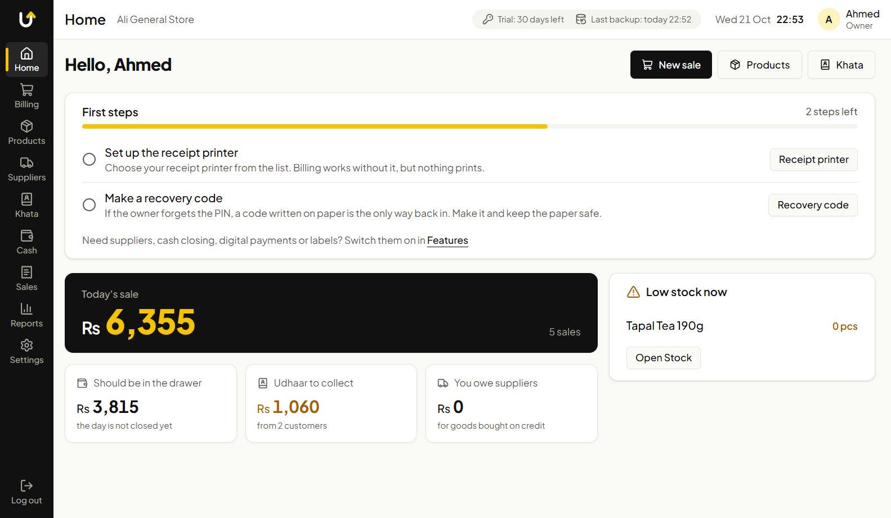
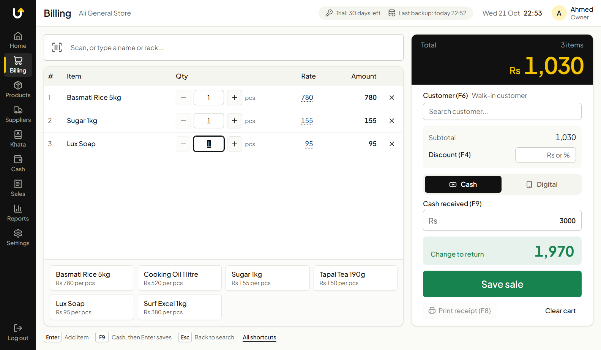
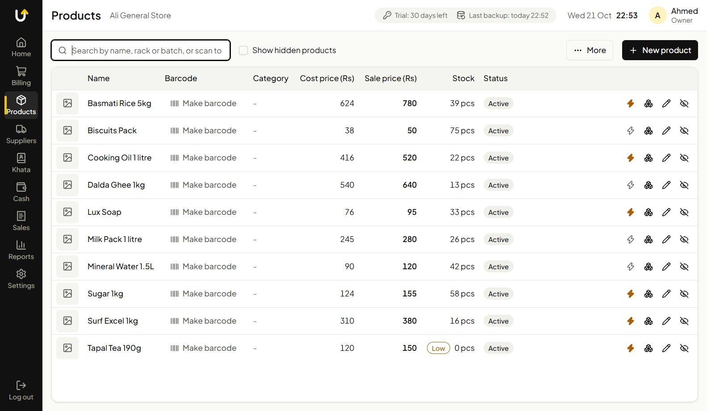
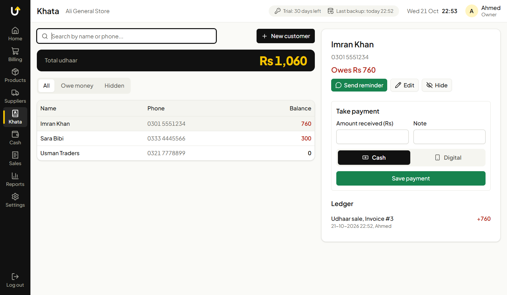
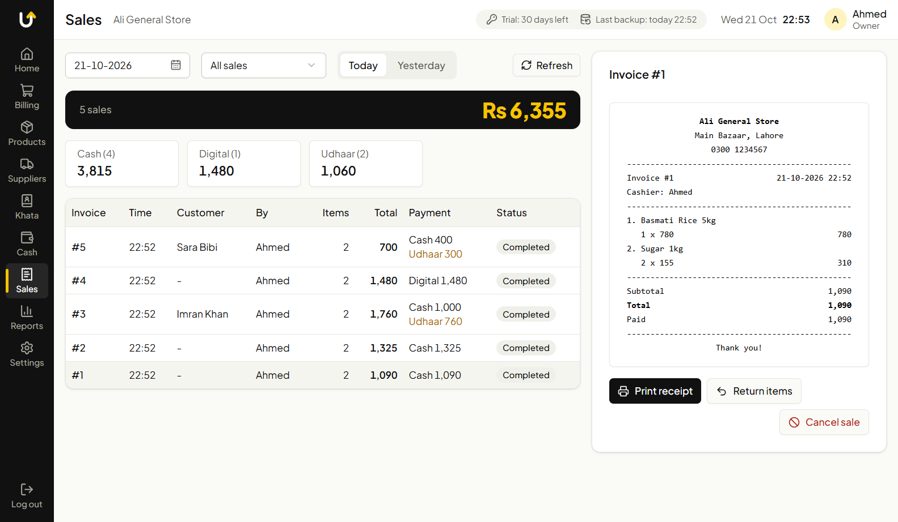
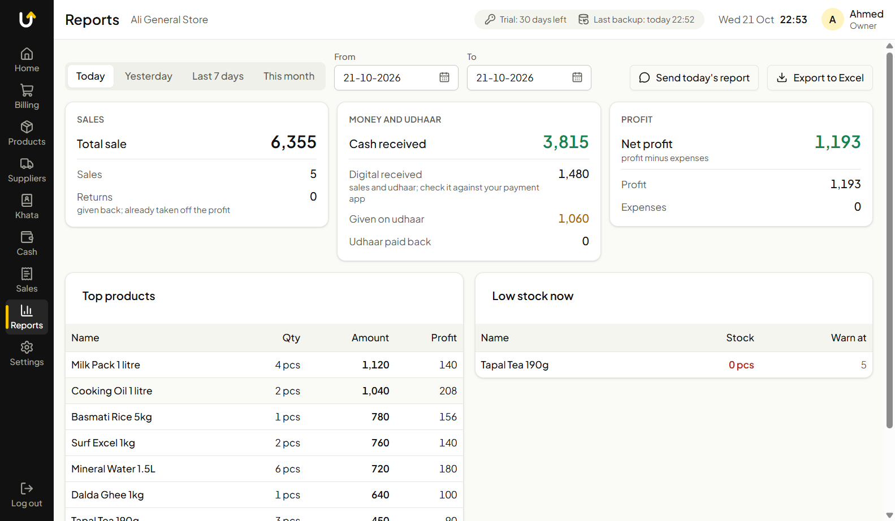

# Up24 Sale System

A product of Up24 Solutions: a point-of-sale app for small shops in Pakistan: kiryana stores, general
stores, medical stores and the like. It runs on a Windows PC, works fully
**offline**, and keeps all of the shop's data on that PC. No internet, server
or monthly fee is needed to sell.

The screens and the receipt can be in **English or Urdu**.

## Screenshots

| | |
| --- | --- |
|  |  |
| **Home**: the day at a glance | **Billing**: scan or tap, the change is shown big |
|  |  |
| **Products**: stock, prices, quick buttons | **Khata**: udhaar, payments, WhatsApp reminder |
|  |  |
| **Sales**: every bill, reprint, cancel | **Reports**: sales, cash, udhaar and profit |

## Download

Get the latest installer (`Up24-Sale-System-Setup-<version>.exe`) from
[Releases](https://github.com/hassanjavedawan/up24-pos-setup/releases/latest).

1. Run the installer. It needs no admin rights and installs in a few seconds.
2. Windows may say **"Windows protected your PC"** (the installer is not
   code-signed). Click **More info**, then **Run anyway**.
3. On first start, choose the language, the shop name and the owner's PIN.

Needs Windows 10 or 11 (64-bit).

## What it does

**Selling**
- Fast billing by barcode scanner, keyboard or quick buttons
- Sell by quantity, by weight (up to 3 decimals) or by amount ("Rs 100 of sugar")
- Discount as rupees or as a percent ("10%"); the owner sets how much discount
  a cashier may give
- Cash or digital payment (JazzCash / Easypaisa, with the shop's own QR), with
  an optional fixed tax added to bills paid digitally
- Wholesale: more than one rate per product, prices per carton, and a credit
  limit for each customer
- Receipts and WhatsApp messages in English or Urdu, with the shop's logo.
  A print window lets you choose language, copies and logo, preview, save a PDF
  or print. Choose the printer from the list of printers Windows knows (USB
  and paired Bluetooth ones included), receipt printer or a normal page printer.
- Filter the sales list by cash, digital and udhaar

**Khata (udhaar)**
- Customer accounts, payments received, full history
- Udhaar reminders sent on WhatsApp

**Stock**
- Products with barcodes, cost and sale price, low-stock warnings, optional
  pictures and a rack for each product
- Units with their full names (Kilogram, Dozen...) and your own units
- Expiry dates and batches, for medical stores and others (first expiry sold
  first; expired stock is never sold without the owner)
- Sizes and colors for clothes and shoes: make every size and color of one
  article in one go, each with its own stock and barcode
- Scan goods in from suppliers; scan and count stock
- Print barcode labels on A4 sheets for loose items
- Import products from Excel

**Money and reports**
- Daily cash closing and expenses
- Returns and refunds
- Suppliers: purchases, purchase orders (sent on WhatsApp or printed, turned
  into a purchase when the goods arrive) and what the shop owes
- Daily, monthly and profit reports, export to Excel, daily summary on WhatsApp

**Safe data**
- Two kinds of users: owner and cashier. Only the owner can cancel sales,
  change prices, see profit or restore a backup.
- Forgot the PIN? A recovery code, written on paper when the shop is set up,
  lets the owner choose a new one.
- Automatic daily backups in `Documents\Up24-Backups`, zipped and checked every
  time. The owner chooses how many days are kept (30 to start with) and can also
  keep one backup per week for older weeks. Restore from Settings.
- Sales are never deleted, only cancelled, so the record stays complete.

Features a shop does not need (wholesale, tax, sizes and colors, suppliers...)
can be switched off in **Settings > Features**.

## Updates

The app checks this page for a new version by itself. A new version is
downloaded in the background and installed when the app is closed. Before any
update that changes the database, the app saves a copy of the shop's data in
the backup folder.

Every update is signed. The app refuses an update that is not signed by the
publisher.

## License

The app runs free for 30 days. After that it needs a license key, entered in
**Settings > License**. Contact the developer for a key.

When a license ends, selling stops but the shop's data stays fully readable,
and backups keep working.

## Where the data is

| What | Where |
| --- | --- |
| Shop database | `%APPDATA%\up24-sale-system` |
| Backups | `Documents\Up24-Backups` (can be changed in Settings; zipped `.db.gz` files) |

Uninstalling the app does **not** delete the shop's data.
