# Up24 Sale System

A product of Up24 Solutions: a point-of-sale app for small shops in Pakistan: kiryana stores, general
stores, medical stores and the like. It runs on a Windows PC, works fully
**offline**, and keeps all of the shop's data on that PC. No internet, server
or monthly fee is needed to sell.

The screens and the receipt can be in **English or Urdu**, in a light or a **dark** look.

Selling never needs the internet. A shop that wants it can also switch on the optional **Cloud** (Settings > Cloud),
so that the owner can read the shop's sales, udhaar and stock on an **Android phone**. See "Cloud and the owner's phone" below.

**Website:** [pos.up24solutions.com](https://pos.up24solutions.com/) has the full details and features of Up24 Sale System.

## Screenshots

| | |
| --- | --- |
| 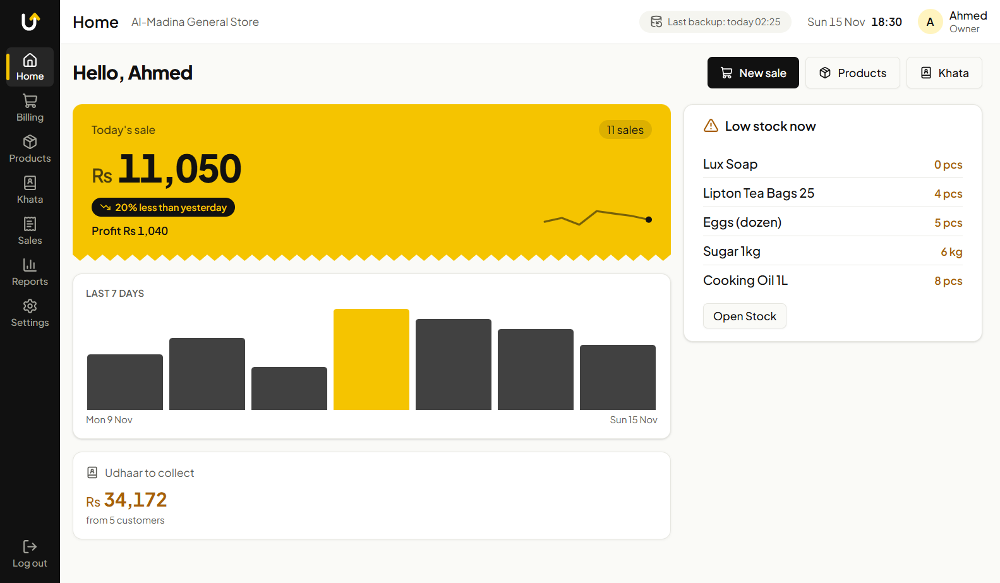 | 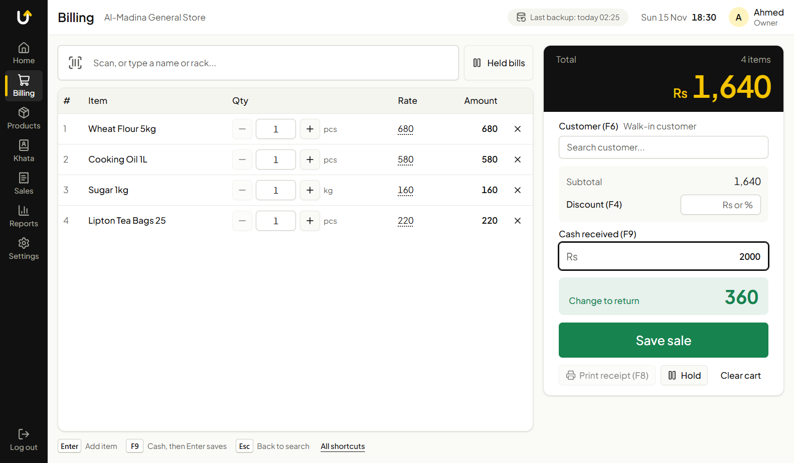 |
| **Home**: today's sale first, compared with yesterday, the last 7 days, low stock | **Billing**: scan or type, the change is shown big |
| 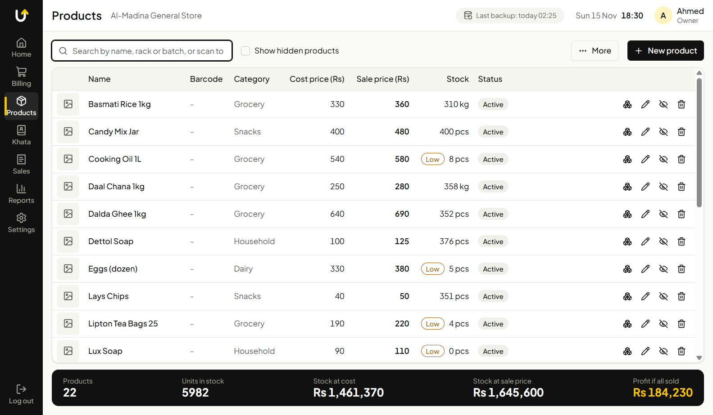 | 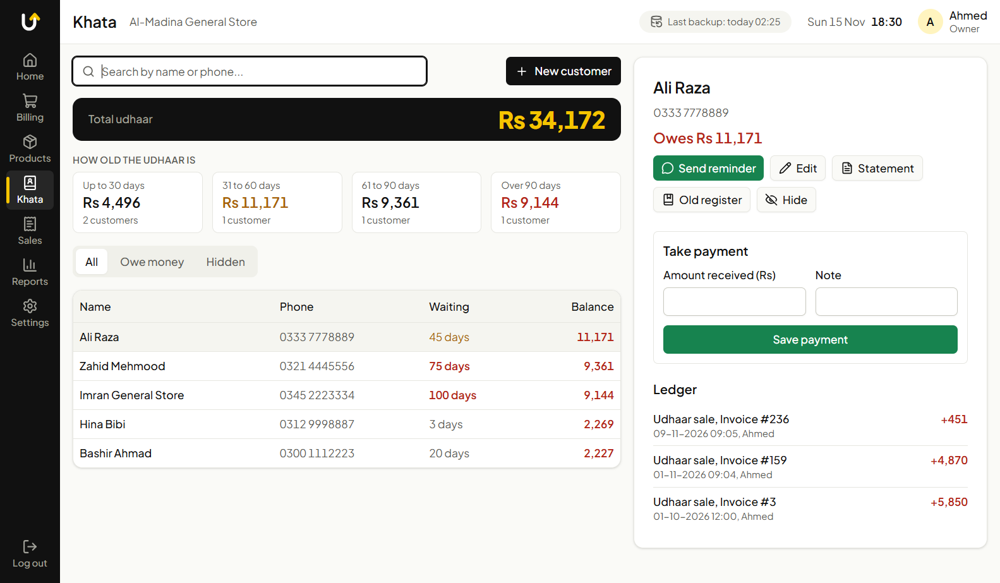 |
| **Products**: stock, prices, low-stock warnings | **Khata**: udhaar by age, payments, WhatsApp reminder |
| 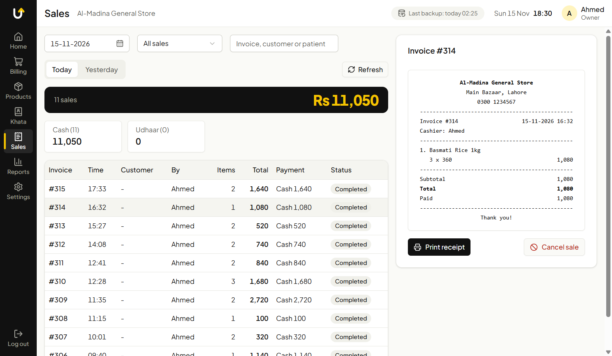 | 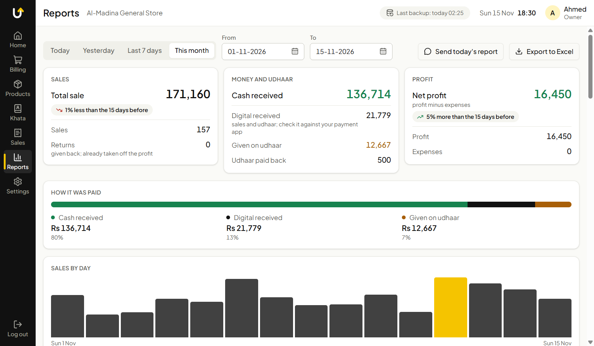 |
| **Sales**: every bill, reprint, cancel | **Reports**: sales, how it was paid, profit, charts |
| 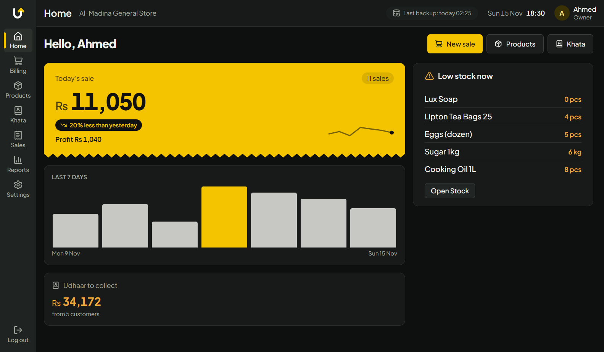 | 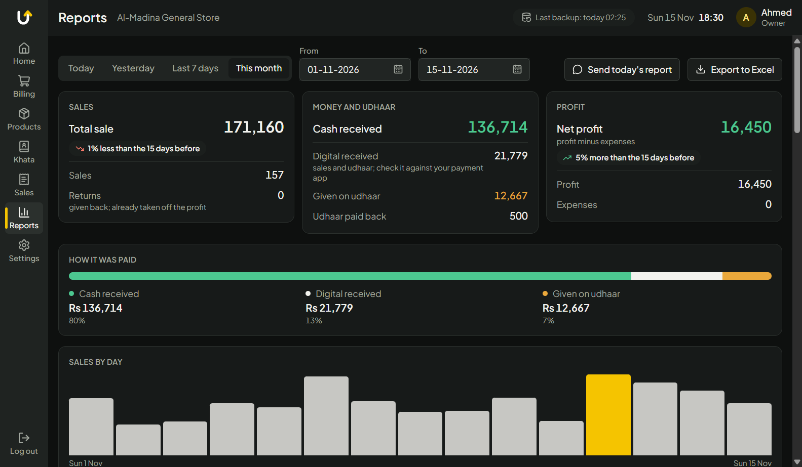 |
| **Dark look**: Settings > Look, "Like Windows", "Light" or "Dark" | The same charts in the dark |

The pictures show a made-up shop (Al-Madina General Store) with made-up sales.

### The bill

A 58 mm or 80 mm thermal bill can be laid out in different ways (Settings > Receipt printer > Bill layout, with a preview).
The bill printed right after a sale also shows what the customer handed over and the change, and a small
"Powered by Up24 Sale System" line at the bottom (it can be switched off).

| | |
| --- | --- |
| 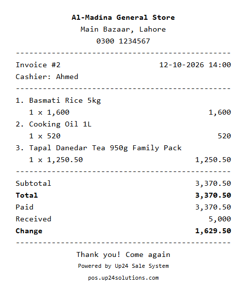 | 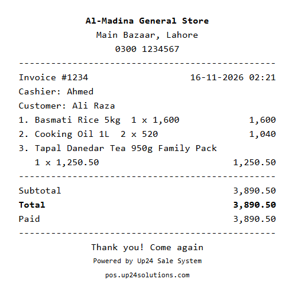 |
| **Standard**: an item on two lines; Received and Change under Paid | **Compact**: an item on one line, less paper |
| 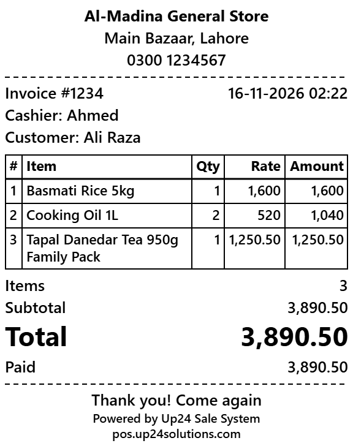 | 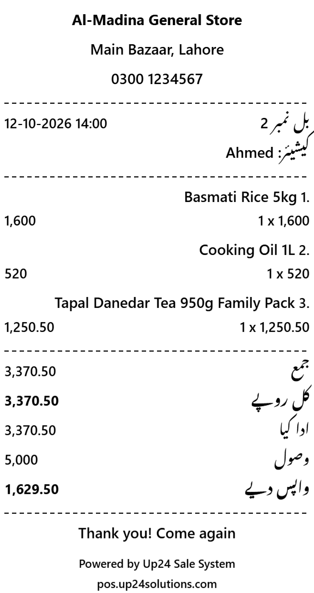 |
| **Table**: real lines (printed as a picture), a bigger total if you want | **Urdu**: the bill in Urdu, printed as a picture |

## Download

Get the latest installer (`Up24-Sale-System-Setup-<version>.exe`) from
[Releases](https://github.com/hassanjavedawan/up24-pos-setup/releases/latest).

1. Run the installer. It needs no admin rights and installs in a few seconds.
2. Windows may say **"Windows protected your PC"** (the installer is not
   code-signed). Click **More info**, then **Run anyway**.
3. On first start, choose the language, the shop name and the owner's PIN.

Needs Windows 10 or 11 (64-bit).

## What it does

**Selling**
- Fast billing by barcode scanner, keyboard or quick buttons
- Sell by quantity, by weight (up to 3 decimals) or by amount ("Rs 100 of sugar")
- Medicines: find a medicine by its formula (salt) and see the other brands with the same one; sell by the tablet or by any unit you make (strip, packet, box, blister...), each at its own price, with one line per medicine and a unit selector (or the keys S, P, B, T); receive stock by the box; expiry dates and batches, with an expiry list on the home screen; patient, doctor and prescription number on the bill
- Put a bill on hold (F3) and serve the next customer; held bills (F7) and the patient details (F10) are a key away; print or send a customer's khata statement (A4, PDF or WhatsApp)
- Discount as rupees or as a percent ("10%"); the owner sets how much discount
  a cashier may give
- Cash or digital payment (JazzCash / Easypaisa, with the shop's own QR), with
  an optional fixed tax added to bills paid digitally
- Wholesale: more than one rate per product, prices per carton, and a credit
  limit for each customer
- Receipts and WhatsApp messages in English or Urdu, with the shop's logo. A 58 mm or 80 mm bill can be standard, compact
  (one line for an item) or a table with real lines and columns (printed as a picture), with the total twice as big, and the cashier, the number of items and the
  customer's phone on or off (Settings > Receipt printer, with a preview). The bill printed after a sale also shows what the customer
  handed over and the change.
  The print window opens after every sale (switch it off in Settings) with the receipt preview shown; choose language, copies and logo, save a PDF
  or print. Receipt paper: 58 mm, 80 mm, A4 page or A5 page. Choose the printer from the list of printers Windows knows (USB
  and paired Bluetooth ones included), receipt printer or a normal page printer.
- Filter the sales list by cash, digital and udhaar

**Khata (udhaar)**
- Customer accounts, payments received, full history
- Udhaar reminders sent on WhatsApp
- A payment cycle for each customer (7, 15, 30 or your own number of days): Home lists who is due today, with a button to send the reminder
- A wrong payment or old register line can be corrected or cancelled by the owner (it stays in the ledger, marked cancelled); old register lines start on today and the time now

**Stock**
- A short product form: the main fields first; barcode, category, rack, expiry, variants, medicine, supplier, warranty and picture open with a switch
- Products with barcodes, cost and sale price, low-stock warnings, optional
  pictures and a rack for each product
- Any number of units for a product (strip, packet, box, carton...), each with its own pieces and price
- A product can carry a warranty (printed on the receipt), a supplier, and "no discount" (a bill's discount does not come off its price)
- Units with their full names (Kilogram, Dozen...) and your own units
- Expiry dates and batches, for medical stores and others (first expiry sold
  first; expired stock is never sold without the owner)
- Variants: sizes and colors for clothes and shoes, or a list of kinds of one article (flavors, brands), each with its own cost, price, stock and barcode
- Scan goods in from suppliers; scan and count stock
- Print barcode labels on A4 sheets for loose items
- Import products from Excel

**Money and reports**
- Daily cash closing and expenses
- Returns and refunds
- Suppliers: purchases, purchase orders (sent on WhatsApp or printed, turned
  into a purchase when the goods arrive) and what the shop owes
- Daily, monthly and profit reports, export to Excel, daily summary on WhatsApp
- Charts without extra software: today's sale against yesterday and the last 7 days, how it was paid (cash, digital, udhaar), the busy hours of the day, profit for each day, what to order again (how many days it will last), and what has stopped selling and the money tied up in it
- Khata shows how old each udhaar is (up to 30 days, 31 to 60, 61 to 90, over 90)

**Easy to start**
- A tour of the screens for a new shop (again from Settings > About), and a "What is new" window after every update
- Settings > Features: switch on only what your shop uses
- Settings > Look: a colour, the shop's logo, larger text, and a light or dark look ("Like Windows" by default; the choice is for each computer)

**More than one computer**
- Counters: other PCs of the shop can sell through the main PC over the shop's own network (Settings > Counters), each with its own login. The main PC keeps the data.

**Safe data**
- Two kinds of users: owner and cashier. Only the owner can cancel sales,
  change prices, see profit or restore a backup.
- Forgot the PIN? A recovery code, written on paper when the shop is set up,
  lets the owner choose a new one.
- Automatic daily backups in `Documents\Up24-Backups`, zipped and checked every
  time. The owner chooses how many days are kept (30 to start with) and can also
  keep one backup per week for older weeks. Restore from Settings.
- Sales are never deleted, only cancelled, so the record stays complete.

Features a shop does not need (wholesale, tax, sizes and colors, suppliers...)
can be switched off in **Settings > Features**.

## Cloud and the owner's phone (optional)

The offline app above is the whole product. A shop can add the **Cloud** from **Settings > Cloud**: the shop's PC then sends its
sales, stock and khata to the shop's own space on the Up24 server, and keeps selling if the internet goes away.
It is the same installer and the same version, switched on or off by the shop. Ask the developer to open a shop space for you.

### Why switch it on

- **See the shop when you are not in it.** The day's sale, how it was paid and the profit are on your phone, so you do not have to phone the cashier at closing time.
- **Know who owes you, and for how long.** Udhaar by age (up to 30 days, 31 to 60, 61 to 90, over 90), customer by customer, and what the shop owes its suppliers.
- **Order before you run out.** What is low, how many days each item will last, how many to order, sent as a list on WhatsApp to your supplier. And what has stopped selling, and what is about to expire.
- **Look at any bill.** Every item, the money, what was returned, and the profit on it.
- **A second copy of your data, away from the shop.** The shop's data is also kept on the server, which copies it every night. The PC's own daily backup stays as it is.
- **More than one shop on one phone**, and the last thing read is kept on the phone, so it still opens with no signal.
- **Private.** The phone asks for a PIN each time it opens (and after a minute away), cannot change a price, and the PDF report never shows the profit.

Selling still happens on the shop's PC, and the PC never needs the internet to sell.

| | | |
| --- | --- | --- |
| 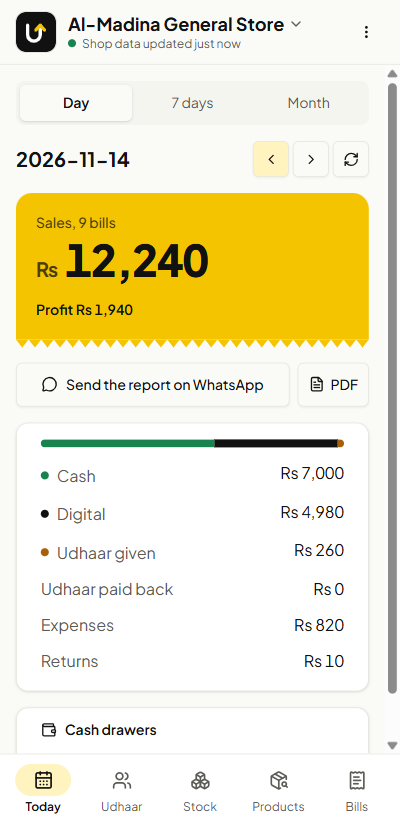 | 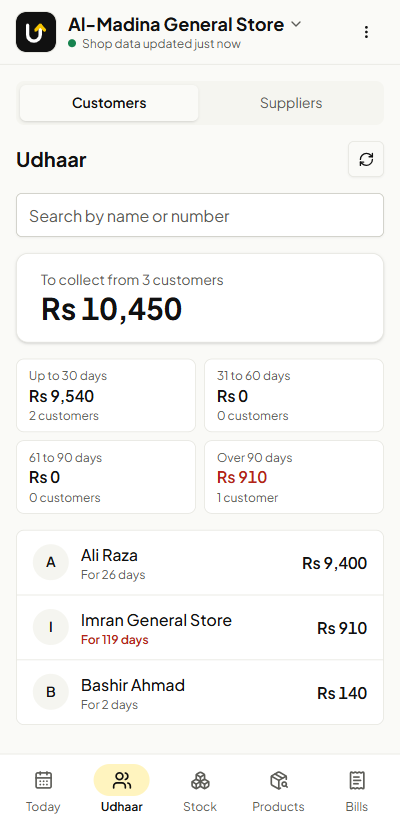 | 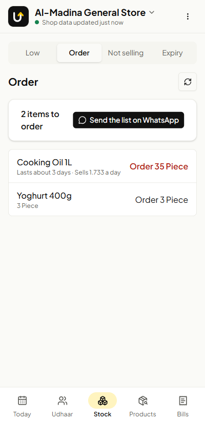 |
| **Today**: sale, how it was paid, expenses, WhatsApp or PDF | **Udhaar**: who owes, for how many days | **Order**: how long it lasts, how many to order |
| 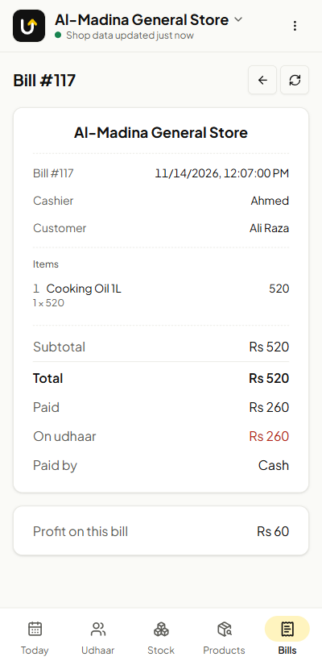 | 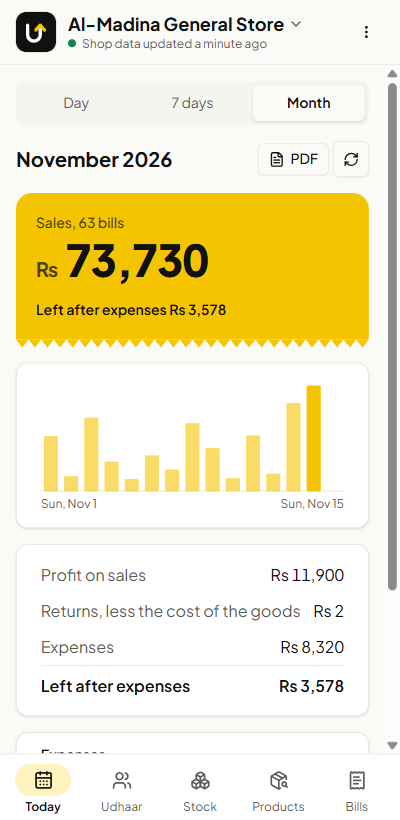 | 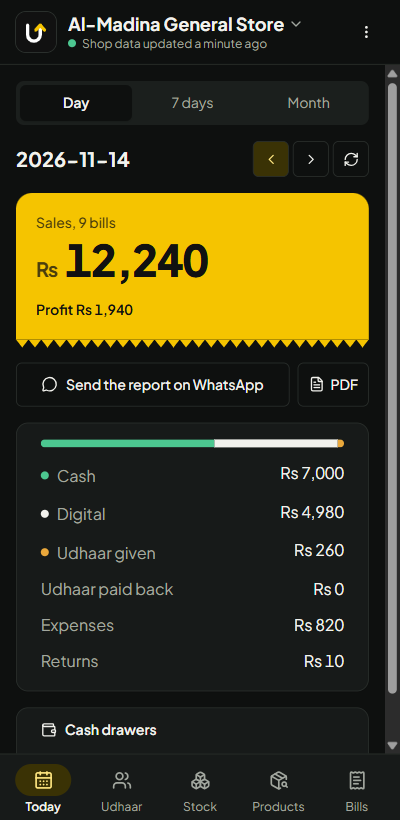 |
| **Bill**: every item, the money, the profit | **Month**: profit after expenses | **Dark look**, and Urdu with right-to-left screens |

### What the owner phone app does

The app is for Android (an APK that the developer hands out; there is no store). It reads the shop, it does not sell:
- Today: the day's sale, how it compares, a month view with the profit after expenses, the day's report on WhatsApp or as a PDF (English or Urdu, never with the profit)
- Bills in full, udhaar with how old each is, suppliers and what the shop owes them
- Stock: what is low, what to order, what has stopped selling, what is about to expire; a product's prices and how it sold
- Scan a barcode with the camera, and count the stock of a product (asks for the PIN again; the main PC gets the count like any other)
- More than one shop on one phone, a copy of what was last read (so it opens with no signal), an evening notice with the day's sales, a PIN lock, light or dark, English or Urdu
- The phone is told of a new version by the server and installs it over the old one

## Updates

The app checks this page for a new version by itself. A new version is
downloaded in the background and installed when the app is closed. Before any
update that changes the database, the app saves a copy of the shop's data in
the backup folder.

Every update is signed. The app refuses an update that is not signed by the
publisher.

## License

The app runs free for 10 days (15 for shops that were already using it before the change). After that it needs a license key, entered in
**Settings > License**. Contact the developer for a key.

A key can also carry a last day for updates; releases made after it are not installed (the app keeps working).

When a license ends, selling stops but the shop's data stays fully readable,
and backups keep working.

## Where the data is

| What | Where |
| --- | --- |
| Shop database | `%APPDATA%\up24-sale-system` |
| Backups | `Documents\Up24-Backups` (can be changed in Settings; zipped `.db.gz` files) |

Uninstalling the app does **not** delete the shop's data.
